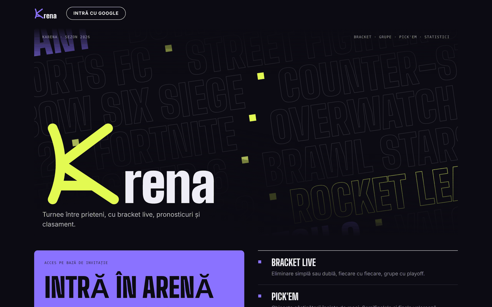
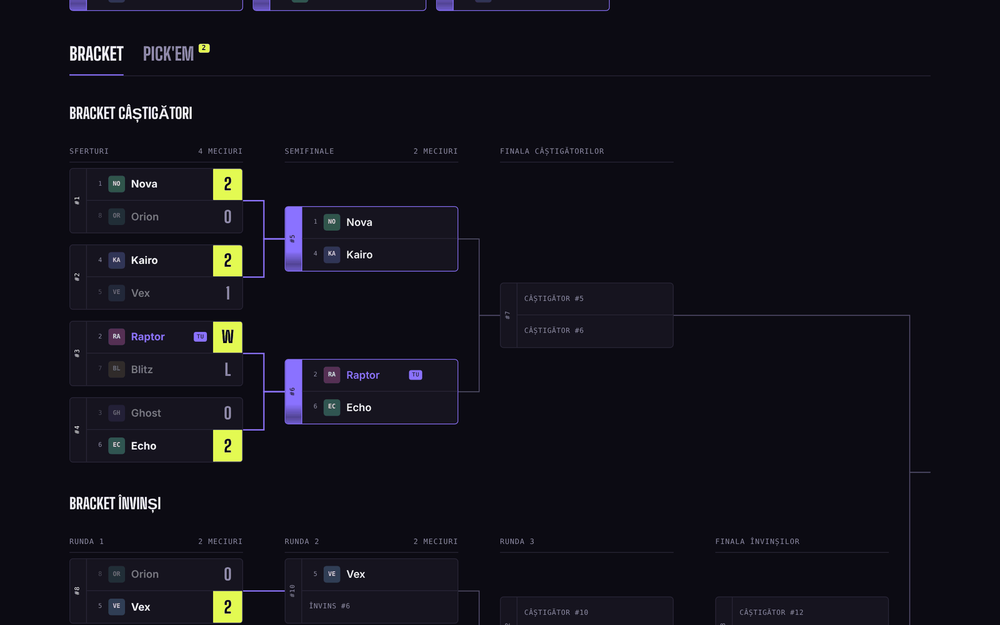
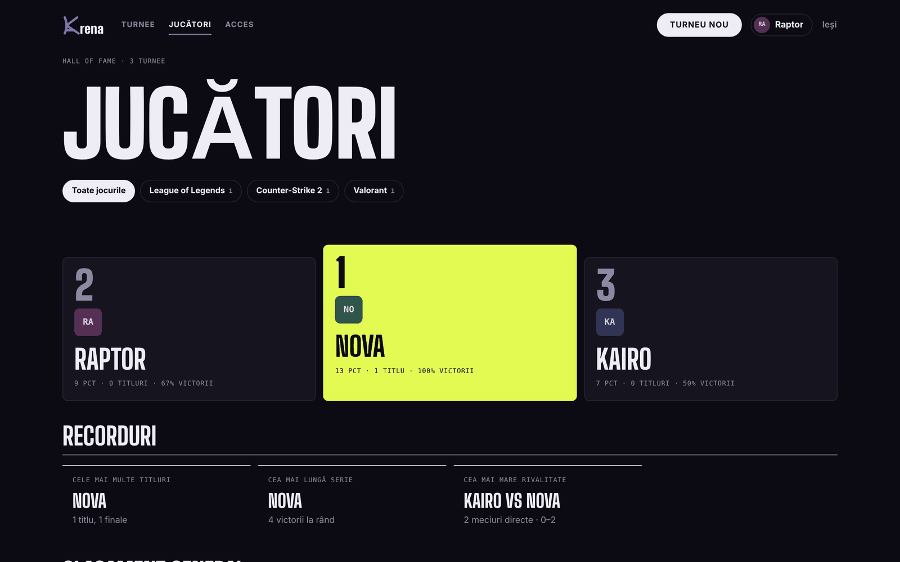
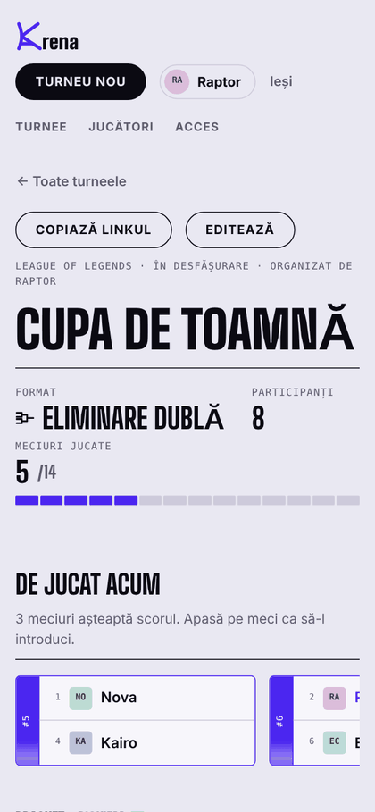

<p align="center">
  
</p>

<h1 align="center">kArena</h1>

<p align="center">
  Turnee între prieteni, cu bracket live, pronosticuri și clasament.<br />
  <a href="https://khaled-arena.web.app"><b>khaled-arena.web.app</b></a>
</p>

<p align="center">
  
  
  
</p>



## Ce face

kArena organizează turnee de gaming pentru un grup de prieteni. Organizatorul creează turneul, introduce scorurile, iar toată lumea vede bracket-ul actualizându-se pe loc.

- **Patru formate**: eliminare simplă, eliminare dublă (cu bracket de învinși și finală cu meci decisiv), fiecare cu fiecare, grupe + playoff.
- **Bracket live**: meciurile sunt legate prin linii, câștigătorul avansează singur, iar fiecare jucător își vede meciurile evidențiate.
- **Scor sau doar câștigător**: pentru 1v1 se alege câștigătorul cu un click.
- **Înscrieri prin link**: turneul se poate deschide pentru înscrieri, cu limită de locuri și termen.
- **Pick'em**: membrii ghicesc câștigătorii înainte de meci. Semifinalele și finala valorează mai mult, iar votul se închide pe server când apare rezultatul.
- **Hall of Fame**: titluri, procente, serii de victorii și rivalități, pe toate jocurile sau pe fiecare joc în parte.
- **Abandonuri**: un jucător retras pierde automat meciurile rămase, fără să strice bracket-ul.



<table>
  <tr>
    <td width="70%"></td>
    <td width="30%"></td>
  </tr>
</table>

## Acces

Site-ul e privat: cine se loghează cu Google trimite automat o cerere, iar organizatorul o aprobă.

| Rol | Ce poate |
| --- | --- |
| **Admin** | aprobă accesul, dă drept de creare, poate șterge orice turneu |
| **Creator** | creează turnee și le gestionează doar pe ale lui |
| **Membru** | vede tot, se înscrie, votează la Pick'em, își alege porecla |
| **Vizitator** | vede doar pagina de prezentare |

Toate regulile sunt verificate pe serverul Firebase, în [`firestore.rules`](firestore.rules), nu doar în pagină.

## Pornire locală

Ai nevoie de Node.js 18 sau mai nou și de acces la un proiect Firebase.

```bash
npm install
cp .env.example .env.local   # apoi pune cheia web Firebase în .env.local
npm run dev                  # http://localhost:5173
```

Publicare (site + reguli de securitate):

```bash
npm run deploy
```

Cheia web Firebase nu e în repository. Se citește din `.env.local`, care e exclus din Git, și e restricționată în Google Cloud la domeniile site-ului.

## Structura

```
src/
  lib/engine.js   logica turneelor: bracket, clasamente, Pick'em, statistici (fără React)
  state/          sesiunea (cine e logat), datele live, notificări
  components/     bracket, carduri de meci, tabele, ferestre de rezultat și poreclă
  pages/          o pagină pentru fiecare adresă din site
firestore.rules   cine are voie să citească și să scrie
```

Logica din `src/lib/engine.js` e separată de interfață: tot ce se vede pe site (cine avansează, clasamente, campion, statistici) se calculează din participanți și rezultate, așa că o corectură de scor se propagă singură peste tot.
